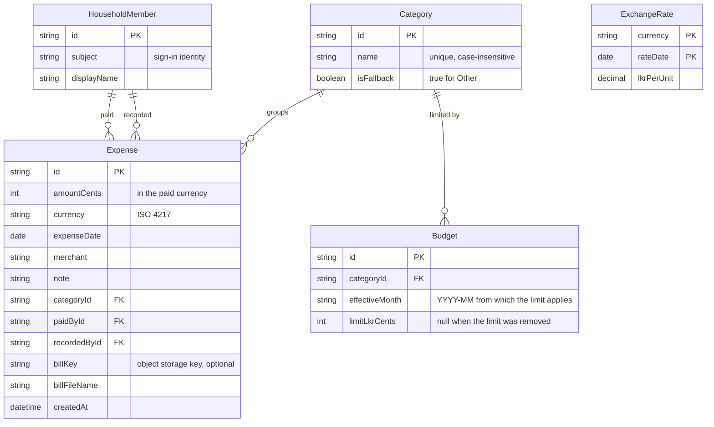

# Domain model

The household's records: two members, the categories they share, their expenses (each in the currency it was paid in, with an optional bill), monthly category budgets, and cached exchange rates used to show everything in LKR.

- A category has no limit until a Budget row exists for it; a changed limit adds a row with a later `effectiveMonth`, so past months keep the limit they had.
- LKR amounts are not stored on an expense; they are computed from `ExchangeRate`.